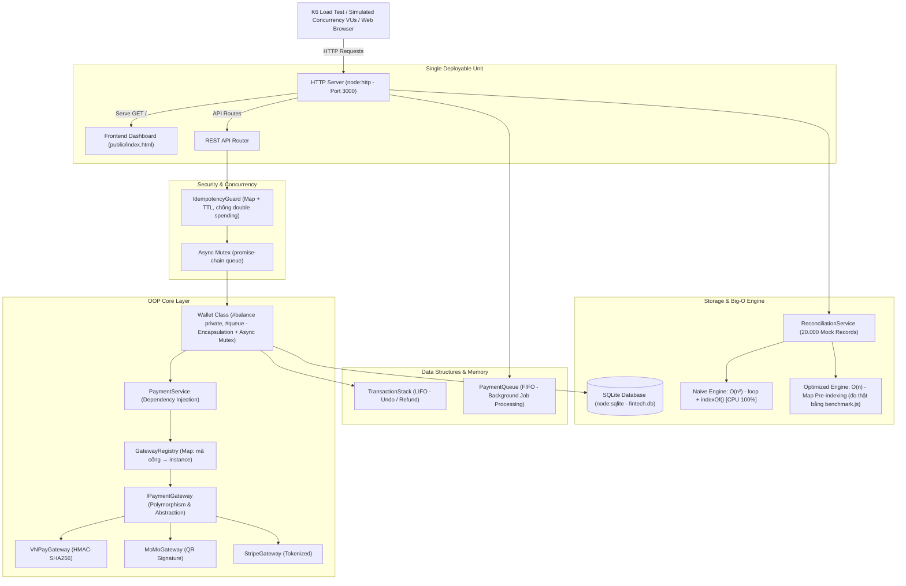

# ĐẶC TẢ KỸ THUẬT (SPECIFICATION): FINTECH PAYMENT & RECONCILIATION ENGINE

## Hệ Thống Thanh Toán & Đối Soát Giao Dịch Chịu Tải Cao (K6 Load-Tested)

> [!IMPORTANT]
> **QUY TẮC BẮT BUỘC THEO DÕI TIẾN ĐỘ THỰC HIỆN:**
> - Mỗi khi hoàn thành xong 1 Task: Đánh dấu `[x]` vào Task đó.
> - Mỗi khi hoàn thành toàn bộ Task của 1 Story: Đánh dấu `[x]` vào Story đó.
> - Theo dõi và cập nhật trực tiếp tại: [STORIES_VA_TASKS_FINTECH_K6.md](file:///c:/onboard/buoi_2_ky_thuat_lap_trinh/SPEC&STORY&TASK/STORIES_VA_TASKS_FINTECH_K6.md)

- **Tên dự án:** `FinTech Payment & High-Concurrency Reconciliation Engine`
- **Vị trí tài liệu SPEC:** [SPEC_FINTECH_PAYMENT_K6_ENGINE.md](file:///c:/onboard/buoi_2_ky_thuat_lap_trinh/SPEC&STORY&TASK/SPEC_FINTECH_PAYMENT_K6_ENGINE.md)
- **Vị trí file Tasks:** [STORIES_VA_TASKS_FINTECH_K6.md](file:///c:/onboard/buoi_2_ky_thuat_lap_trinh/SPEC&STORY&TASK/STORIES_VA_TASKS_FINTECH_K6.md)
- **Thư mục mã nguồn:** [c:\onboard\buoi_2_ky_thuat_lap_trinh\fintech-payment-engine](file:///c:/onboard/buoi_2_ky_thuat_lap_trinh/fintech-payment-engine)

---

## 1. BẢNG TECHSTACK TOÀN DIỆN & TRIẾT LÝ KIẾN TRÚC

| Thành phần | Công nghệ lựa chọn | Lý do kỹ thuật & Giá trị thực chiến |
| :--- | :--- | :--- |
| **Runtime & Môi trường** | **Node.js v22.15.0+** (pin `NODE_VERSION=22.15.0`) | Hỗ trợ ES Private Fields (`#field`), Async/Await, REST thuần. **Yêu cầu cứng:** `node:sqlite` chỉ tồn tại từ Node **22.5**, nên Node 18/20 **không chạy được** dự án này. Trên 22.15 không cần flag; Node chỉ in `ExperimentalWarning` — chấp nhận được. |
| **Cơ sở dữ liệu (Database)** | **SQLite (`data/fintech.db`)** — `node:sqlite` (DatabaseSync) | Module lõi, không cần `sqlite3`/`better-sqlite3`, không cần C++ build tools. **DB là nguồn sự thật duy nhất của số dư**; RAM chỉ là cache đọc, mọi thay đổi ghi xuống DB ngay trong luồng xử lý. Bật `PRAGMA journal_mode = WAL` + `PRAGMA busy_timeout = 5000` để tránh `SQLITE_BUSY` khi 50 request ghi đồng thời. Số tiền lưu `INTEGER` (VND không có phần lẻ) để so khớp đối soát chính xác. |
| **Độ phụ thuộc bên ngoài** | **Zero External Dependencies** | **100% không dùng thư viện ngoài qua npm** — kể cả test (`node --test` có sẵn). `k6` là công cụ ngoài chạy bằng binary, không phải npm dependency, và luôn có `simulate-load.js` làm đường chạy thay thế trên máy chưa cài k6. |
| **Backend REST Core** | `node:http`, `node:crypto`, `node:events` | Tự dựng máy chủ HTTP REST, xử lý băm mật mã HMAC-SHA256 (VNPay), quản lý hàng đợi Event-Driven. |
| **Frontend Web Dashboard** | **Vanilla HTML5 + Modern CSS3 Dark Mode + JS** | Đóng gói tại `public/index.html`. Không cần React, Vite hay Webpack. Trực quan hóa số dư thời gian thực, nút kích nổ Race Condition, và biểu đồ so sánh Big-O. |
| **Mô hình triển khai** | **Monolith Tí Hon (Single Deployable Artifact)** | **Backend tự phục vụ Frontend (Static File Serving) và Database trong đúng 1 tiến trình (Single Process, Single Port 3000)**. Không cấu hình CORS, không Nginx reverse proxy, không tách repo. |
| **Kiểm thử tải (Load Test)** | **K6 Script (`k6-script.js`, 50 VUs) + `simulate-load.js`** | Kịch bản K6 chính thức + script nội bộ dùng `Promise.all` bắn 50 requests đồng thời rút tiền từ 1 ví để kiểm chứng Mutex Lock. **50 là con số VUs duy nhất trong toàn bộ tài liệu** — mọi chỗ khác đều tham chiếu về đây. |
| **Chiến lược Deploy** | **Localhost-First & 1-Click Render.com** | • **Chạy Local:** 1 lệnh `node src/server.js` là lên trọn vẹn toàn bộ hệ thống.<br>• **Cloud (Tùy chọn):** Đẩy lên GitHub và chọn Web Service trên Render.com, nhận link HTTPS công khai trong 1 phút.<br>• **Cảnh báo:** filesystem Render free là **tạm** — `data/fintech.db` mất sau mỗi lần restart/ngủ (xem §7.3). |

---

## 2. BỐI CẢNH & TRIẾT LÝ CỐT LÕI (WHY & MINDSET)

Hầu hết các lỗi thảm họa trong ngành FinTech / Ngân hàng số không đến từ việc không biết cú pháp, mà đến từ:
1. **Lơ là Đóng gói (Encapsulation Flaws):** Trạng thái số dư ví (`balance`) bị chỉnh sửa tự do từ bên ngoài, không kiểm soát luồng giao dịch, dẫn đến việc dữ liệu bị sai lệch.
2. **Ảo tưởng về Happy Case:** Không lường trước được hiện tượng **Race Condition** khi hàng chục tiến trình cùng gửi lệnh rút tiền trên một ví tại cùng một mili-giây.
3. **Bẫy Vòng Lặp Ẩn ($O(n^2)$ Under Load):** Khi dữ liệu đối soát cuối ngày lên tới hàng chục nghìn giao dịch, việc dùng `find()/filter()` lồng trong vòng lặp làm CPU nhảy lên 100%, Event Loop bị đóng băng và server sập hoàn toàn.
4. **Thiếu tính linh hoạt (Tight Coupling):** Viết cứng các cổng thanh toán (VNPay, MoMo, Stripe) bằng chuỗi `if/else` rối rắm, vi phạm nguyên tắc Đa hình & Dependency Injection.

**Mục tiêu của dự án:** Xây dựng một cỗ máy FinTech Mini chuẩn công nghiệp kết hợp nhuần nhuyễn cả **4 Trụ Cột OOP**, **Tối ưu Thuật toán Big-O**, và **Kiểm thử chịu tải thực tế bằng K6**.

---

## 3. KIẾN TRÚC TỔNG THỂ & CÁC TRỤ CỘT KỸ THUẬT



---

## 4. CẤU TRÚC THƯ MỤC DỰ ÁN (`fintech-payment-engine`)

```
c:\onboard\buoi_2_ky_thuat_lap_trinh\fintech-payment-engine/
├── data/
│   ├── fintech.db               # Nguồn sự thật của số dư (kèm -wal/-shm khi bật WAL; KHÔNG commit)
│   └── mockFintechData.js       # 20.000 log ngân hàng + 20.000 giao dịch nội bộ (source='SEED'), seed ví WAL-8892
├── public/
│   └── index.html               # Frontend Mission Control Dashboard (Dark Mode)
├── src/
│   ├── database/
│   │   └── db.js                # Quản lý kết nối SQLite thuần (node:sqlite) & khởi tạo bảng
│   ├── structures/
│   │   ├── TransactionStack.js  # LIFO: Quản lý lịch sử giao dịch & Rollback/Refund
│   │   └── PaymentQueue.js      # FIFO: Hàng đợi xử lý lệnh thanh toán ngầm
│   ├── core/
│   │   ├── Wallet.js            # OOP Đóng gói: #balance private, Atomic Mutex Lock
│   │   └── Transaction.js       # Model giao dịch bất biến (Immutable State)
│   ├── gateways/                # OOP Đa hình & Trừu tượng (Polymorphism & Abstraction)
│   │   ├── IPaymentGateway.js   # Lớp cơ sở trừu tượng quy định hợp đồng charge/refund
│   │   ├── VNPayGateway.js      # Cổng VNPay (Ký checksum SHA-256)
│   │   ├── MoMoGateway.js       # Cổng MoMo (Mô phỏng chữ ký QR Code)
│   │   ├── StripeGateway.js     # Cổng Stripe (Xử lý token thẻ quốc tế)
│   │   └── registry.js          # Map mã cổng → instance (nơi DUY NHẤT map "VNPAY")
│   ├── services/
│   │   ├── PaymentService.js    # Tầng Service điều phối, áp dụng Dependency Injection
│   │   └── ReconciliationService.js # BIG-O THỰC CHIẾN: Đối soát O(n²) vs O(n) dùng Map
│   ├── security/
│   │   └── IdempotencyGuard.js  # SET O(1): Ngăn chặn lặp lệnh thanh toán (Anti-Double Spending)
│   └── server.js                # Máy chủ HTTP chuẩn REST & Serve Web UI (Port 3000)
├── tests/                       # node --test — không cần npm install
│   ├── wallet.test.js           # Đóng gói, validate, 50 request đồng thời
│   ├── structures.test.js       # Stack/Queue + độ phức tạp
│   ├── idempotency.test.js      # Trùng key, namespace theo ví, TTL
│   └── reconciliation.test.js   # So khớp naive vs optimized
├── benchmark.js                 # CLI Benchmark: Đo đạc tốc độ đối soát 20.000 bản ghi
├── simulate-load.js             # Bộ bắn tải đa luồng nội bộ (Giả lập K6 bắn 50 requests)
├── k6-script.js                 # Kịch bản chính thức cho công cụ K6 (50 VUs)
├── render.yaml                  # File cấu hình deploy 1-click lên Render.com (Miễn phí)
└── index.js                     # Kịch bản mô phỏng chạy thử nghiệm đầu cuối trên Terminal
```

---

## 5. THIẾT KẾ CƠ SỞ DỮ LIỆU SQLITE (`src/database/db.js`)

Cơ sở dữ liệu SQLite được khởi tạo tự động khi máy chủ chạy lần đầu:

```sql
-- Bắt buộc ngay sau khi mở kết nối:
--   PRAGMA journal_mode = WAL;    -- tránh SQLITE_BUSY khi 50 request ghi đồng thời
--   PRAGMA busy_timeout = 5000;   -- chờ tối đa 5s thay vì fail ngay

-- 1. Bảng lưu trữ ví tiền (balance là INTEGER đồng — VND không có phần lẻ)
CREATE TABLE IF NOT EXISTS wallets (
    id TEXT PRIMARY KEY,
    owner TEXT NOT NULL,
    balance INTEGER NOT NULL DEFAULT 0,
    created_at TEXT NOT NULL
);

-- 2. Bảng lưu trữ lịch sử giao dịch
--    DB là NGUỒN SỰ THẬT của số dư; RAM chỉ là cache đọc.
CREATE TABLE IF NOT EXISTS transactions (
    id TEXT PRIMARY KEY,
    wallet_id TEXT NOT NULL,
    tx_code TEXT NOT NULL,       -- KHOÁ ĐỐI SOÁT: khớp bank_statement_logs.tx_code
    type TEXT NOT NULL,          -- 'DEPOSIT', 'WITHDRAW', 'REFUND'
    amount INTEGER NOT NULL,
    gateway TEXT,                -- 'INTERNAL', 'VNPAY', 'MOMO', 'STRIPE'
    status TEXT NOT NULL,        -- 'SUCCESS', 'REJECTED'
    idempotency_key TEXT,
    source TEXT NOT NULL DEFAULT 'LIVE',  -- 'LIVE' = thao tác thật | 'SEED' = 20.000 dòng mock
    created_at TEXT NOT NULL,
    FOREIGN KEY(wallet_id) REFERENCES wallets(id)
);

CREATE INDEX IF NOT EXISTS idx_tx_code ON transactions(tx_code);
CREATE INDEX IF NOT EXISTS idx_wallet_created ON transactions(wallet_id, created_at);

-- 3. Bảng dữ liệu đối soát ngân hàng (20.000 records)
CREATE TABLE IF NOT EXISTS bank_statement_logs (
    id TEXT PRIMARY KEY,
    tx_code TEXT NOT NULL UNIQUE,
    amount INTEGER NOT NULL,
    bank_timestamp TEXT NOT NULL
);

-- 4. Bảng lưu kết quả từng lượt đối soát (để so sánh O(n²) và O(n) sau này)
CREATE TABLE IF NOT EXISTS recon_results (
    id INTEGER PRIMARY KEY AUTOINCREMENT,
    batch_id TEXT NOT NULL,
    strategy TEXT NOT NULL,      -- 'NAIVE' | 'OPTIMIZED'
    tx_code TEXT NOT NULL,
    verdict TEXT NOT NULL,       -- 'MATCH' | 'AMOUNT_MISMATCH' | 'MISSING_IN_BANK' | 'MISSING_INTERNAL'
    internal_amount INTEGER,
    bank_amount INTEGER,
    duration_ms INTEGER NOT NULL,
    created_at TEXT NOT NULL
);

CREATE INDEX IF NOT EXISTS idx_recon_batch ON recon_results(batch_id);
```

**Ghi chú dữ liệu seed:** 20.000 dòng mock luôn có `source='SEED'` và `wallet_id='WAL-SEED'`, nên **không bao giờ** lẫn vào lịch sử hay số dư của ví thật `WAL-8892`. Đối soát chỉ đọc `source='SEED'`; ví thật chỉ tính `source='LIVE'`. `tx_code` là khoá khớp duy nhất giữa hai bên — nếu thiếu nó ở `transactions` thì thuật toán $O(n)$ không thể chạy đúng.

---

## 6. HỆ THỐNG ENDPOINT HTTP PHỤC VỤ TEST TẢI & GIAO DIỆN

Máy chủ `src/server.js` khởi chạy tại `http://localhost:3000` (Render dùng `process.env.PORT`). Mọi lỗi trả về **một envelope duy nhất**:

```json
{ "error": { "code": "INSUFFICIENT_FUNDS", "message": "Số dư không đủ" } }
```

| # | Method & Path | Request | Thành công | Mã lỗi |
| :-- | :--- | :--- | :--- | :--- |
| 1 | `GET /` | — | `200 text/html` (`public/index.html`) | `404 NOT_FOUND`, `400 BAD_PATH` |
| 2 | `POST /api/wallet/withdraw` | `{"walletId":"WAL-8892","amount":100000,"idempotencyKey":"KEY-123"}` | `200 {"status":"SUCCESS","balance":0,"txId":"..."}` | `404 WALLET_NOT_FOUND`, `400 INVALID_AMOUNT`, `409 INSUFFICIENT_FUNDS`, `409 DUPLICATE` |
| 3 | `POST /api/payment/charge` | `{"walletId":"WAL-8892","gateway":"VNPAY","amount":250000,"idempotencyKey":"KEY-ABC"}` | `200 {"status":"SUCCESS","signature":"<hex 64>","txId":"..."}` | `400 UNKNOWN_GATEWAY`, `400 INVALID_AMOUNT`, `409 DUPLICATE` |
| 4 | `POST /api/reconcile/naive` | `{}` | `200 {"batchId":"...","strategy":"NAIVE","durationMs":N,"matches":N,"mismatches":N}` | `409 RECON_IN_PROGRESS` |
| 5 | `POST /api/reconcile/optimized` | `{}` | như trên, `strategy:"OPTIMIZED"` | `500 INTERNAL` |
| 6 | `GET /api/wallet/balance?walletId=WAL-8892` | query `walletId` | `200 {"walletId":"WAL-8892","balance":0,"source":"db"}` | `400 MISSING_WALLET_ID`, `404 WALLET_NOT_FOUND` |
| 7 | `POST /api/wallet/refund` | `{"walletId":"WAL-8892"}` | `200 {"status":"REFUNDED","amount":100000,"balance":100000}` | `404 WALLET_NOT_FOUND`, `409 NOTHING_TO_REFUND` |
| 8 | `GET /api/wallet/transactions?walletId=WAL-8892&limit=10` | query `walletId`, `limit` (1–100) | `200 {"walletId":"WAL-8892","transactions":[{"type":"WITHDRAW","amount":100000,"status":"SUCCESS"}]}` | `400 MISSING_WALLET_ID`, `404 WALLET_NOT_FOUND` |
| 9 | `GET /api/health` | — | `200 {"ok":true}` | — |

**Quy tắc bắt buộc của API:**

- **`amount` phải là số nguyên dương** (đơn vị đồng). `0`, số âm, số lẻ, `NaN`, `"100000"` (string) đều trả `400 INVALID_AMOUNT` — không được implicit convert.
- **`idempotencyKey` namespace theo ví**: khoá thật là `` `${walletId}:${key}` ``. Nếu không namespace, `KEY-123` của ví A sẽ chặn ví B. TTL 15 phút, lưu RAM (mất khi restart — xem §8).
- **`/api/reconcile/naive` là endpoint demo đồng bộ, có chủ đích làm nghẽn Event Loop**: $O(n^2)$ trên 20.000 bản ghi, chặn cả server khoảng 1 giây (số đo thật in ra từ `benchmark.js`, không hardcode). Chỉ cho **1 lượt tại một thời điểm**, lượt thứ hai nhận `409 RECON_IN_PROGRESS`. **K6 không bắn tải vào endpoint này** (1 VU, 1 iteration — xem Story 5.1).
- Số dư **chỉ đọc từ DB**, không đọc từ RAM; trường `source:"db"` trong response tồn tại để chứng minh điều đó.
- JSON body giới hạn **64KB** (quá → `413 PAYLOAD_TOO_LARGE`); server không trả stack trace ra client.

---

## 7. CHI TIẾN LƯỢC DEPLOY "MONOLITH TÍ HON"

### 7.1. Chạy trên môi trường Localhost (Ưu tiên số 1):
```bash
# Khởi động toàn bộ Database SQLite + Backend API + Frontend Dashboard:
node src/server.js

# Mở trình duyệt truy cập:
http://localhost:3000
```

### 7.2. Triển khai Cloud 1-Click trên Render.com (Tùy chọn):
- Tạo tài khoản miễn phí tại `render.com`.
- Kết nối kho mã nguồn GitHub cá nhân chứa thư mục dự án.
- Thiết lập:
  * **Environment:** `Node`
  * **Node Version:** `22.15.0` — khai báo `NODE_VERSION=22.15.0` (trong `render.yaml` hoặc Environment). Render có thể mặc định bản khác; bản < 22.5 sẽ **không có** `node:sqlite` và server chết ngay khi khởi động.
  * **Build Command:** *(Để trống, vì không có package npm)*
  * **Start Command:** `node src/server.js`
- Hệ thống cấp phát ngay một URL công khai HTTPS: `https://fintech-payment-engine-xxxx.onrender.com`.

### 7.3. Giới hạn của bản deploy Render free (không được hứa "bền vững")

- Filesystem là **tạm**: `data/fintech.db` bị **xoá** sau mỗi lần service restart hoặc ngủ (free tier ngủ sau ~15 phút không có traffic). Dữ liệu **không** tồn tại vĩnh viễn — đây là demo, không phải production.
- Idempotency guard nằm trong RAM → restart là mất toàn bộ key đã đăng ký.
- `/api/reconcile/naive` chặn Event Loop khoảng 1 giây trên 20.000 bản ghi; **không demo naive trên bản cloud** khi đang có traffic khác (Render health check có thể timeout).
- Không có auth: URL công khai nghĩa là ai cũng gọi được `/api/wallet/withdraw`. Chỉ dùng cho demo, **không** gắn với tiền thật.

---

## 8. GIỚI HẠN ĐÃ BIẾT (KNOWN LIMITATIONS)

| Giới hạn | Vì sao chấp nhận | Ảnh hưởng |
| :--- | :--- | :--- |
| Đơn tiến trình, một Event Loop | Đúng mục tiêu "Monolith Tí Hon" | Mutex chỉ đúng trong một tiến trình; không chứng minh được khoá phân tán |
| Idempotency trong RAM, TTL 15' | Tránh thêm bảng + job dọn dẹp | Restart mất key; chạy 2 instance sẽ không chia sẻ key |
| SQLite trên Render free (filesystem tạm) | Không muốn kéo Postgres vào đề bài | Dữ liệu reset sau restart, kể cả ví demo |
| `/api/reconcile/naive` chạy đồng bộ | Chính nó là bài học $O(n^2)$ | Chặn Event Loop; chỉ 1 lượt tại một thời điểm |
| Không auth, không rate limit | Phạm vi buổi học là CTDL / OOP / Big-O | Không được dùng với tiền thật hay dữ liệu thật |
| Số liệu hiệu năng phụ thuộc máy | Không có phần cứng chuẩn để cam kết | Mọi con số phải lấy từ `benchmark.js` / K6 trên máy đang chạy, không hardcode |
