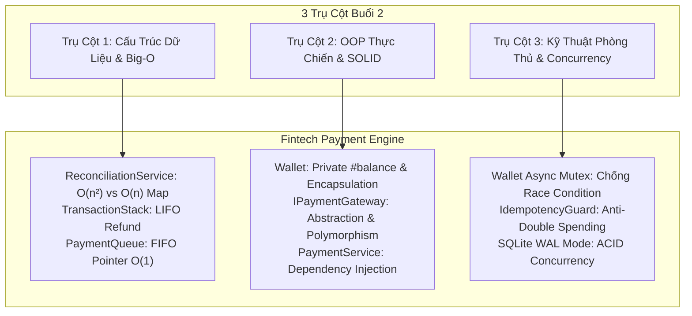

# Phân Tích Ý Tưởng & Hướng Dẫn Vận Hành Dự Án Fintech Payment Engine
## Liên kết trực tiếp với chương trình Buổi 2: Kỹ thuật lập trình thực chiến

---

## I. Ý TƯỞNG DỰ ÁN & BÀI TOÁN THỰC TẾ

### 1. Bối cảnh ngành FinTech & Ngân hàng số
Trong các hệ thống tài chính, ngân hàng số và cổng thanh toán, **dữ liệu tiền tệ là bất khả xâm phạm**. Sai sót một xu hay để lộ lỗ hổng kỹ thuật đều có thể dẫn tới thiệt hại hàng triệu USD hoặc sập toàn bộ hệ thống. 

Những sự cố nghiêm trọng nhất trong FinTech thường không xuất phát từ việc thiếu cú pháp ngôn ngữ, mà do lập trình viên mắc phải **3 điểm mù kinh điển**:
1. **Ảo tưởng về "Happy Case" & Race Condition:** Nghĩ rằng chỉ có 1 người thao tác 1 lúc. Khi mạng chập chờn hoặc kẻ gian cố tình bấm nút 50 lần trong 1 phần nghìn giây, nếu không có cơ chế khóa (Mutex Lock / Locking), tài khoản chỉ có 100.000đ nhưng bị trừ tiền 50 lần (rút ra 5.000.000đ, số dư bị âm).
2. **Bẫy vòng lặp ẩn ($O(n^2)$ Under Load):** Khi dữ liệu chỉ có vài trăm dòng lúc dev, viết `find()` hay `indexOf()` lồng trong vòng lặp chạy rất mượt. Nhưng đến cuối ngày, khi ngân hàng gửi file sao kê 20.000 đến 100.000 giao dịch để **đối soát (reconciliation)**, hệ thống lập tức ngốn 100% CPU, nghẽn Event Loop và sập toàn bộ dịch vụ.
3. **Thanh toán lặp (Double Spending):** Mạng lag, người dùng bấm nút thanh toán 2 lần, hoặc cổng thanh toán gửi webhook trùng lặp khiến người dùng bị trừ tiền hai lần.
4. **Code "Mì ăn liền" vi phạm OOP & SOLID:** Viết cứng logic các cổng VNPay, MoMo, Stripe bằng các chuỗi `if/else` dài dằng dặc trong Controller, trộn lẫn logic ví tiền với cơ sở dữ liệu.

### 2. Ý tưởng cốt lõi của `fintech-payment-engine`
Dự án được xây dựng như một **Capstone Engine chuẩn công nghiệp thu nhỏ (Miniature Industrial Engine)** nhằm hiện thực hóa triết lý: **"Học hiểu bản chất, không học vẹt lý thuyết"** của Buổi 2. 

Toàn bộ dự án:
- **Zero External Dependencies:** 100% thuần Node.js (`node:http`, `node:crypto`, `node:sqlite`). Không dùng Express, không dùng ORM cồng kềnh, không dùng Lodash.
- **Monolith Tí Hon:** Một tiến trình duy nhất vừa phục vụ REST API, vừa quản lý SQLite WAL, vừa serve Web Dashboard trực quan.
- **Thực nghiệm đo đạc bằng số liệu thật:** Mọi lý thuyết về Big-O, Race Condition đều có script benchmark và test tải (K6 / simulate-load) để chứng minh bằng con số mili-giây trên máy thật.

---

## II. BẢNG ÁNH XẠ 1-1: DỰ ÁN GẮN VỚI KIẾN THỨC BUỔI 2 NHƯ THẾ NÀO?

Tài liệu [Nghiệm Thu Kiến Thức Buổi 2.docx](file:///c:/onboard/buoi_2_ky_thuat_lap_trinh/Nghi%E1%BB%87m%20Thu%20Ki%E1%BA%BFn%20Th%E1%BB%A9c%20Bu%E1%BB%95i%202.docx) đặt ra 3 Trụ cột cốt lõi. Dưới đây là bảng đối chiếu chi tiết:



### 1. Trụ cột 1: Cấu trúc Dữ liệu & Tư duy Hiệu năng thực tế (Big-O)

| Khái niệm lý thuyết Buổi 2 | Vị trí hiện thực trong Code | Giải thích chi tiết & Giá trị thực chiến |
| :--- | :--- | :--- |
| **Bẫy vòng lặp ẩn $O(n^2)$** | [src/services/ReconciliationService.js](file:///c:/onboard/buoi_2_ky_thuat_lap_trinh/fintech-payment-engine/src/services/ReconciliationService.js#L31-L59) (`reconcileNaive`) | Trong hàm `reconcileNaive()`, vòng lặp duyệt 20.000 giao dịch nội bộ lồng phương thức `bankCodes.indexOf(tx.code)`. Vì `indexOf` duyệt mảng tuyến tính $O(n)$, độ phức tạp tổng nhảy vọt lên $O(n^2) = 20.000 \times 20.000 = 400.000.000$ phép tính, làm CPU bị nghẽn trong hơn 1 giây. |
| **Tối ưu hóa $O(n)$ bằng Hash Map** | [src/services/ReconciliationService.js](file:///c:/onboard/buoi_2_ky_thuat_lap_trinh/fintech-payment-engine/src/services/ReconciliationService.js#L62-L100) (`reconcileOptimized`) | Chuyển đổi dữ liệu sao kê ngân hàng thành một `Map<tx_code, amount>`. Bước dựng Map tốn $O(n)$, sau đó duyệt mảng nội bộ chỉ tốn tra cứu $O(1)$ qua `bankMap.get(tx.code)`. Tổng thời gian giảm xuống $O(n)$, chạy chỉ mất **96ms** (nhanh hơn **12 lần** so với Naive)! |
| **Cấu trúc Stack (LIFO - Vào sau ra trước)** | [src/structures/TransactionStack.js](file:///c:/onboard/buoi_2_ky_thuat_lap_trinh/fintech-payment-engine/src/structures/TransactionStack.js) | Phục vụ tính năng **Hoàn tiền (Refund / Undo)** giao dịch gần nhất. Đỉnh Stack luôn trỏ vào giao dịch mới nhất (`peek()`, `pop()`). Khi bấm hoàn tiền, hệ thống lấy ngay giao dịch gần nhất để hoàn lại vào ví mà không cần quét toàn bộ bảng. |
| **Cấu trúc Queue (FIFO) & Tránh bẫy `Array.shift()`** | [src/structures/PaymentQueue.js](file:///c:/onboard/buoi_2_ky_thuat_lap_trinh/fintech-payment-engine/src/structures/PaymentQueue.js) | Sinh viên hay dùng `array.shift()` để dequeue, nhưng `shift()` phải dịch chuyển toàn bộ $n$ phần tử về trước $\rightarrow O(n)$ mỗi lần dequeue. Trong `PaymentQueue`, code dùng **con trỏ `#head` tịnh tiến**, biến thao tác dequeue thành **$O(1)$ amortized**, kèm logic dọn dẹp bộ nhớ định kỳ. |

---

### 2. Trụ cột 2: Lập trình Hướng đối tượng (OOP) thực chiến & SOLID

| Khái niệm OOP / SOLID | Vị trí hiện thực trong Code | Giải thích chi tiết & Giá trị thực chiến |
| :--- | :--- | :--- |
| **Đóng gói (Encapsulation) & Data Hiding** | [src/core/Wallet.js](file:///c:/onboard/buoi_2_ky_thuat_lap_trinh/fintech-payment-engine/src/core/Wallet.js#L26-L42) | Sử dụng **ES Private Fields (`#balance`, `#db`, `#queue`)**. Không bất kỳ đối tượng bên ngoài nào có thể sửa đổi biến `#balance` trực tiếp (ví dụ `wallet.balance = 9999999` sẽ vô tác dụng hoặc báo lỗi). Mọi biến động số dư bắt buộc phải đi qua các hàm nghiệp vụ có kiểm tra chặt chẽ (`deposit`, `withdraw`). |
| **Tính Bất biến (Immutability)** | [src/core/Transaction.js](file:///c:/onboard/buoi_2_ky_thuat_lap_trinh/fintech-payment-engine/src/core/Transaction.js) | Lớp `Transaction` áp dụng `Object.freeze(this)`. Một khi giao dịch đã được tạo ra, dữ liệu của nó (mã giao dịch, số tiền, trạng thái, thời gian) bị đóng băng vĩnh viễn, ngăn chặn hoàn toàn việc sửa đổi dữ liệu sau khi ghi sổ. |
| **Trừu tượng (Abstraction) & Kế thừa (Inheritance)** | [src/gateways/IPaymentGateway.js](file:///c:/onboard/buoi_2_ky_thuat_lap_trinh/fintech-payment-engine/src/gateways/IPaymentGateway.js) | Định nghĩa một "bản hợp đồng" trừu tượng quy định mọi cổng thanh toán đều phải có 2 hàm: `charge()` và `refund()`. Nếu lớp con nào kế thừa mà không viết lại (override) 2 hàm này sẽ văng lỗi ngay lúc chạy. |
| **Đa hình (Polymorphism)** | [src/gateways/](file:///c:/onboard/buoi_2_ky_thuat_lap_trinh/fintech-payment-engine/src/gateways/) (`VNPayGateway.js`, `MoMoGateway.js`, `StripeGateway.js`) | Cùng là phương thức `charge({ amount, token })`, nhưng: <br>• **VNPay:** Tạo mã giao dịch và băm chữ ký HMAC-SHA256.<br>• **MoMo:** Sinh chuỗi ký QR code và mô phỏng xác thực thanh toán di động.<br>• **Stripe:** Xử lý và thẩm định token thẻ thanh toán quốc tế.<br>Code gọi bên ngoài chỉ cần gọi `gateway.charge()`, tính đa hình tự động kích hoạt logic riêng của từng cổng mà không cần chuỗi `if/else` phân loại. |
| **Đảo ngược phụ thuộc (Dependency Injection - DI)** | [src/services/PaymentService.js](file:///c:/onboard/buoi_2_ky_thuat_lap_trinh/fintech-payment-engine/src/services/PaymentService.js) & [src/server.js](file:///c:/onboard/buoi_2_ky_thuat_lap_trinh/fintech-payment-engine/src/server.js#L7-L15) | `PaymentService` không tự tiện khởi tạo `new VNPayGateway()` hay tự kết nối Database bên trong nó. Thay vào đó, nó nhận `gateways` (registry) và `db` từ bên ngoài truyền vào thông qua `constructor`. Nhờ đó, việc viết Unit Test với Mock Object trở nên cực kỳ dễ dàng. |
| **Trách nhiệm duy nhất (Single Responsibility - SRP)** | Phân rã thư mục `src/` | • `Wallet`: Quản lý nghiệp vụ số dư & khóa Mutex.<br>• `PaymentService`: Điều phối giao tiếp giữa ví và cổng thanh toán.<br>• `ReconciliationService`: Chuyên trách thuật toán đối soát sao kê.<br>• `IdempotencyGuard`: Chuyên trách chống thanh toán lặp.<br>• `server.js`: Chuyên trách HTTP routing & parse request. |

---

### 3. Trụ cột 3: Kỹ thuật phòng thủ (Defensive Programming) & Concurrency

| Kỹ thuật phòng thủ | Vị trí hiện thực trong Code | Giải thích chi tiết & Giá trị thực chiến |
| :--- | :--- | :--- |
| **Chống Race Condition bằng Async Mutex Lock** | [src/core/Wallet.js](file:///c:/onboard/buoi_2_ky_thuat_lap_trinh/fintech-payment-engine/src/core/Wallet.js#L140-L160) (`#enqueue`) | Khi 50 request cùng ập vào ví `WAL-8892` (đang có 100.000đ) để đòi rút 100.000đ, nếu không khóa thì cả 50 request cùng đọc thấy số dư là 100.000đ và cùng cho rút (số dư thành -4.900.000đ). <br>Bằng cách dùng chuỗi `Promise` làm **Mutex Queue (`#queue = this.#queue.then(...)`)**, mọi thao tác rút tiền trên 1 ví được xếp hàng tuần tự hóa: **Request 1 vào rút thành công, số dư về 0đ; 49 request sau vào thấy số dư 0đ lập tức bị từ chối với lỗi `INSUFFICIENT_FUNDS`**. |
| **Chống lặp giao dịch (Anti-Double Spending / Idempotency)** | [src/security/IdempotencyGuard.js](file:///c:/onboard/buoi_2_ky_thuat_lap_trinh/fintech-payment-engine/src/security/IdempotencyGuard.js) | Áp dụng `Map` lưu trữ `Idempotency-Key` kèm cơ chế thời gian sống (TTL = 15 phút). Khi một request mang cùng một key gửi tới lần 2, hệ thống chặn ngay lập tức với mã lỗi `DUPLICATE_REQUEST` trong thời gian $O(1)$, không để lệnh lọt vào xử lý ví. |
| **SQLite WAL Mode & Concurrency** | [src/database/db.js](file:///c:/onboard/buoi_2_ky_thuat_lap_trinh/fintech-payment-engine/src/database/db.js#L60-L75) | Bật `PRAGMA journal_mode = WAL;` (Write-Ahead Logging) và `PRAGMA busy_timeout = 5000;`. Cho phép các luồng đọc và luồng ghi chạy song song mà không khóa lẫn nhau, triệt tiêu lỗi `SQLITE_BUSY` khi bị bắn tải nặng. |

---

## III. CẨM NANG HƯỚNG DẪN VẬN HÀNH & KIỂM THỬ TOÀN DIỆN

### 1. Chuẩn bị môi trường
- Yêu cầu duy nhất: **Node.js v22.15.0+** (để hỗ trợ `node:sqlite`).
- Không cần cài bất kỳ package npm nào (`npm install` là tùy chọn vì zero-dependency).

### 2. Khởi chạy máy chủ cục bộ (Localhost)
Mở terminal tại thư mục `fintech-payment-engine`:

```bash
cd c:\onboard\buoi_2_ky_thuat_lap_trinh\fintech-payment-engine
node src/server.js
```

- Khi khởi chạy lần đầu, server sẽ tự động tạo file `data/fintech.db` và seed:
  - **20.000** giao dịch nội bộ.
  - **20.000** dòng sao kê ngân hàng.
  - Ví demo `WAL-8892` thuộc sở hữu của `Nguyen Van A` với số dư ban đầu: **100.000 đ**.
- Truy cập Dashboard trực quan tại trình duyệt: **`http://localhost:3000`**.

---

### 3. Hướng dẫn sử dụng Web Dashboard (`public/index.html`)

Giao diện Dashboard gồm 4 khu vực tác nghiệp chính:
1. **Thanh Header & Trạng thái Hệ thống:**
   - Hiển thị chấm trạng thái màu xanh (`ONLINE`), tự động ping `/api/health`.
   - Hiển thị số dư thời gian thực của ví `WAL-8892` (100.000 đ).
2. **Khu vực Rút tiền & Kích nổ Race Condition:**
   - **Nút "Rút tiền (1 lần)":** Rút tiền bình thường qua API `/api/wallet/withdraw`.
   - **Nút "Hoàn tiền (Stack LIFO)":** Thu hồi lại giao dịch gần nhất, cộng tiền ngược lại vào ví.
   - **Nút "Bắn 50 request cùng lúc (Race Condition Test)":** Gửi đồng thời 50 request rút 100.000đ. Bạn sẽ chứng kiến tận mắt: **1 request báo xanh (SUCCESS), 49 request báo đỏ (INSUFFICIENT_FUNDS), số dư ví về đúng 0đ chứ không bao giờ bị âm!**
3. **Khu vực Nạp tiền qua Cổng đa hình (Gateways):**
   - Chọn cổng (VNPay / MoMo / Stripe) và số tiền.
   - Xem log mã checksum SHA-256 (VNPay) hoặc chữ ký QR (MoMo) được tạo tự động.
4. **Khu vực Đối soát Giao dịch (Big-O Demonstration):**
   - **Nút "Chạy đối soát O(n²)":** Chạy thuật toán Naive. Thời gian thực thi ~1.200ms.
   - **Nút "Chạy đối soát O(n)":** Chạy thuật toán Optimized dùng Map. Thời gian thực thi ~90ms.
   - Biểu đồ thời gian và bảng kết quả hiển thị tỷ lệ tăng tốc vượt trội (~12x).

---

### 4. Các lệnh kiểm thử & Đo đạc hiệu năng tự động (CLI)

#### A. Chạy trọn bộ Unit Test (21 bài test)
Chạy bộ test có sẵn của Node.js:
```bash
node --test
```
*Kết quả:* 21/21 test pass trong ~0.2 giây, kiểm thử toàn bộ từ Private Fields, Mutex Lock, Stack LIFO, Queue FIFO đến tính bất biến của Transaction.

#### B. Chạy Benchmark đo đạc Big-O trên dữ liệu thật
```bash
node benchmark.js
```
*Kết quả:* In bảng so sánh chi tiết thời gian chạy và dung lượng RAM giữa Naive $O(n^2)$ và Optimized $O(n)$ trên 20.000 bản ghi thực trong SQLite.

#### C. Chạy kịch bản bắn tải đa luồng nội bộ (Simulate Load)
```bash
node simulate-load.js
```
*Kết quả:* Tự động kích hoạt 50 request đồng thời để kiểm chứng bất biến: Không bao giờ bị trừ tiền quá số dư.

#### D. Bắn tải bằng công cụ K6 chuyên nghiệp (Nếu máy đã cài K6)
```bash
# Kiểm tra cú pháp kịch bản:
k6 run --vus 1 --duration 1s k6-script.js

# Bắn tải đầy đủ 50 Virtual Users:
k6 run k6-script.js
```

---

## IV. TỔNG KẾT BÀI HỌC KỸ THUẬT

Dự án `fintech-payment-engine` là minh chứng sống động cho việc:
> **"Lý thuyết lập trình không nằm trên sách vở, nó là vũ khí bảo vệ hệ thống trước sự cố ngoài đời thực."**

- **Học OOP** không phải để thuộc lòng định nghĩa, mà là biết dùng **Private Fields** để bảo vệ số dư tài khoản và dùng **Polymorphism** để thêm cổng thanh toán mới mà không phải sửa code cũ.
- **Học Cấu trúc Dữ liệu & Big-O** không phải để giải đố leetcode, mà là biết dùng **Hash Map** để cứu hệ thống đối soát khỏi bị sập CPU khi dữ liệu tăng từ 1.000 lên 100.000 dòng.
- **Học Kỹ thuật phòng thủ** là luôn mặc định rằng mạng sẽ chập chờn, người dùng sẽ bấm đúp, và hàng chục request sẽ ập vào cùng một phần triệu giây.
